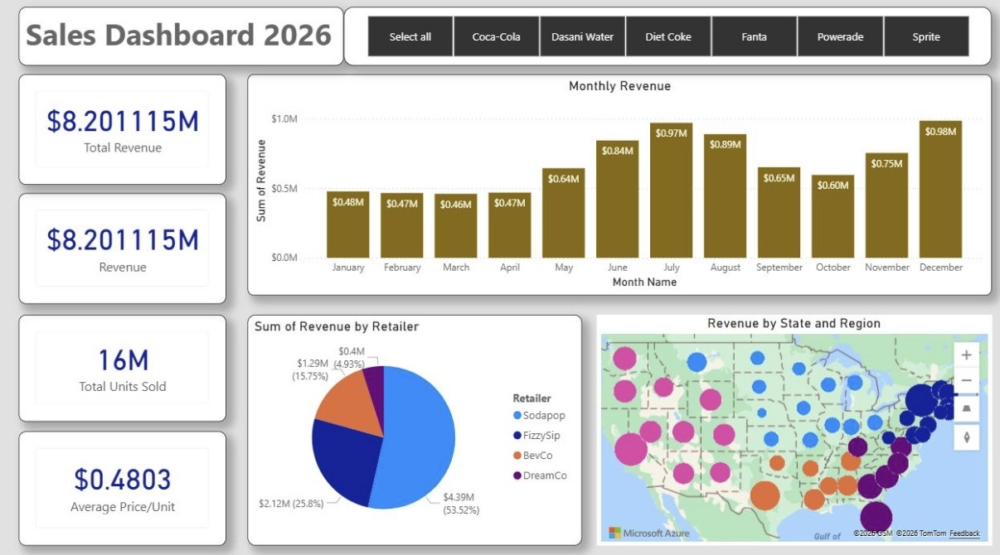
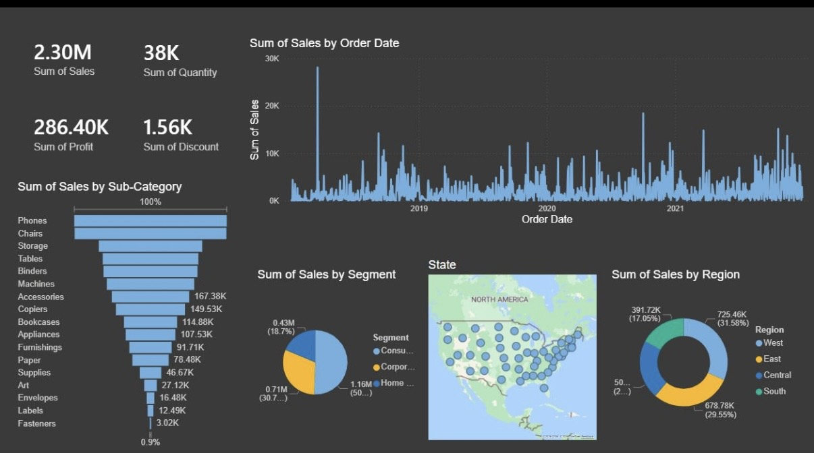

# PowerBI-Sales-Dashboard

## Dashboard 1: Superstore Sales Analysis

An interactive Power BI dashboard analyzing retail sales performance across products, customer segments, and regions.

### Key Metrics
- **Total Sales:** 2.30M
- **Quantity:** 38K
- **Profit:** 286.40K
- **Discount:** 1.56K

### Visuals Used
- Line chart: sales trend by order date (2018 to 2021)
- Funnel chart: sales by sub-category
- Pie chart: sales by customer segment
- Map: sales by state
- Donut chart: sales by region

### Key Insights
- Phones and Chairs are the top-selling sub-categories, while Fasteners and Labels sell the least.
- The Consumer segment contributes about 50% of sales, followed by Corporate (30.7%) and Home Office (18.7%).
- The West (31.58%) and East (29.55%) regions lead in sales, while the South contributes 17.05%.

---

## Dashboard 2: Beverage Sales Dashboard 2026

A Power BI dashboard tracking beverage revenue by month, retailer, and state, with brand slicers (Coca-Cola, Dasani, Diet Coke, Fanta, Powerade, Sprite).

### Key Metrics
- **Total Revenue:** $8.2M
- **Units Sold:** 16M
- **Average Price per Unit:** $0.48

### Key Insights
- Revenue peaks in July ($0.97M) and December ($0.98M), and is lowest in March ($0.46M).
- Sodapop is the largest retailer with 53.52% of revenue, followed by FizzySip (25.8%).
- Revenue is concentrated in the East and Southeast.

---

## Tools Used
Power BI, DAX, Power Query
